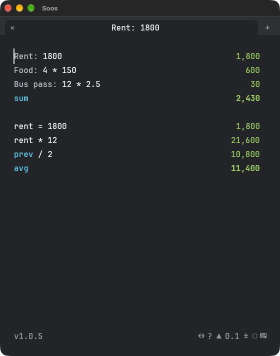

<div align="center">


# Soos

A notepad-style calculator for Windows, macOS, Linux and Android: every line
is an expression, and its answer shows up beside it.

[](https://github.com/marelevn/soos/releases/latest/download/soos-windows-x86_64.zip)
[](https://github.com/marelevn/soos/releases/latest/download/Soos.dmg)
[](https://github.com/marelevn/soos/releases/latest/download/soos-linux-x86_64.tar.gz)
[](https://github.com/marelevn/soos/releases/latest/download/soos-android.apk)

Windows 64-bit (Intel or AMD) · macOS (Apple silicon or Intel) · Linux
64-bit (Intel or AMD) · Android 8 or newer (64-bit)



[](https://github.com/marelevn/soos/actions/workflows/ci.yml)
[](https://github.com/marelevn/soos/releases/latest)
[](LICENSE)

</div>

## Download

| Platform | How |
|---|---|
| Windows | Download [`soos-windows-x86_64.zip`](https://github.com/marelevn/soos/releases/latest/download/soos-windows-x86_64.zip), extract it to a folder you'll keep (Soos saves your tabs in a `data` folder beside it), and run `soos-app.exe`. |
| macOS | Download [`Soos.dmg`](https://github.com/marelevn/soos/releases/latest/download/Soos.dmg) and drag Soos to Applications. Or run `brew install --cask marelevn/tap/soos`, which also puts `soos-cli` on your `PATH`. |
| Linux | Download [`soos-linux-x86_64.tar.gz`](https://github.com/marelevn/soos/releases/latest/download/soos-linux-x86_64.tar.gz), extract it to a folder you can write to, and run `soos-app`. |
| Android | Download [`soos-android.apk`](https://github.com/marelevn/soos/releases/latest/download/soos-android.apk) and open it. Allow your browser or Files app to install apps when Android asks. Soos isn't on Google Play. |

Soos isn't signed yet, so Windows and macOS warn you the first time you open
it. The Homebrew cask clears macOS's quarantine flag itself. For the
warnings and how to get past them, and for updating and uninstalling, see
[Install help](docs/install-help.md).

## Quick guide

Open Soos and type a calculation, like `12 * 3` (`*` means times); the
answer appears on the right. A whole document looks like this:

    Rent: 1800                     1,800
    Food: 4 * 150                    600
    Bus pass: 12 * 2.5                30
    sum                            2,430

    rent = 1800                    1,800
    rent * 12                     21,600
    prev / 2                      10,800
    avg                           11,400

- `Rent:` is a label: only what follows it is calculated.
- A blank line, a `# heading` or a label alone on its line (`Costs:`) starts
  a new block.
- `sum` (or `total`) adds up the lines above it in its block.
- `avg` (or `average`) averages them. Every line with a result counts,
  `rent = 1800` included: the second block's `avg` is 11,400.
- `prev` is the previous result.
- `rent = 1800` makes a variable for every line below it. A label doesn't
  make a variable: `Rent:` above it doesn't count.

More in [Totals and variables](docs/totals.md).

## Features

Soos calculates with [fend](https://github.com/printfn/fend) and adds rules
of its own.

- [Phrases](docs/phrasing.md): `5% on 30`, `4 plus 4`, `20 sq cm`.
- [Currency](docs/money-and-units.md): `$8 * 3`, `20 EUR in USD`, with saved
  rates for offline use. Amounts [round](docs/money-and-units.md#rounding)
  to the currency's usual decimals, and `≈` marks a result that isn't exact.
- [Units](docs/money-and-units.md#units): `20 inches in cm`. `in` also means
  inches, so `5 ft 11 in` is 5 feet 11 inches.
- [Your own units](docs/money-and-units.md#your-own-converters): a small
  table, kept apart from your text.
- [Dates and time zones](docs/dates-and-time.md): `today + 3 days`,
  `3PM PST in Tokyo`. Write a date as `@2026-12-25` and a time with capital
  `AM` or `PM`.
- [Decimal comma](docs/the-app.md#decimal-comma): `,` groups thousands and
  `.` is the decimal point, so `1,5` is 15. The `0.1` button in the status
  bar swaps them.
- [Tabs](docs/the-app.md#tabs): up to 9 scratchpads, saved when you close
  Soos.
- [Tray icon and hotkey](docs/the-app.md#tray-dock-and-hotkey): bring Soos
  up from any app (Windows and macOS).
- [On Android](docs/the-app.md#on-android): tap a result to copy it.
- [In a terminal](docs/soos-cli.md): `soos-cli '20 inches in cm'` prints
  `50.8 cm`.
- [PowerToys Run](docs/powertoys.md): type `=20 inches in cm` there (Windows;
  you build the plugin from this repository).

Soos goes online for two things, and sends no user data with either:
refreshing exchange rates, and checking for a new version when you click the
version number in the status bar (desktop only).

## Docs

[The guide](docs/README.md) shows every topic with examples.

- [The app](docs/the-app.md): tabs, status bar, tray, Android, error labels
- [Totals and variables](docs/totals.md)
- [Phrases](docs/phrasing.md)
- [Money and units](docs/money-and-units.md)
- [Dates and time zones](docs/dates-and-time.md)
- [soos-cli](docs/soos-cli.md)
- [PowerToys Run plugin](docs/powertoys.md)
- [Install help](docs/install-help.md): install, update, uninstall, first-run warnings

## Build from source

Install Rust 1.95 or newer, then:

```
git clone https://github.com/marelevn/soos.git
cd soos
cargo build --release -p soos-app -p soos-cli
```

The programs are `target/release/soos-app` and `target/release/soos-cli`.
[CONTRIBUTING.md](CONTRIBUTING.md) covers Linux build dependencies, the
Android app, the checks CI runs and the release process.

## Contributing, security and license

- Contributing: see [CONTRIBUTING.md](CONTRIBUTING.md); open pull requests
  against `dev`.
- Security: report a vulnerability privately, as [SECURITY.md](SECURITY.md)
  describes.
- License: [MIT](LICENSE).

## Credits

Built on [fend](https://github.com/printfn/fend) (the calculating),
[egui/eframe](https://github.com/emilk/egui) and other MIT or Apache-2.0
crates listed in the `Cargo.toml` files. The typeface is
[JetBrains Mono](https://www.jetbrains.com/lp/mono/) under the
[SIL Open Font License 1.1](assets/fonts/OFL.txt); currency signs it lacks
come from [DejaVu Sans Mono](https://dejavu-fonts.github.io/) under
[its license](assets/fonts/DejaVu-LICENSE.txt). Exchange rates come from
[Frankfurter](https://frankfurter.dev). Thanks to
[Numi](https://github.com/nikolaeu/numi) for the idea.
