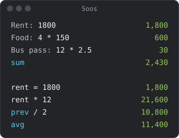
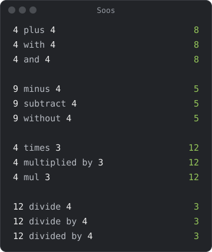
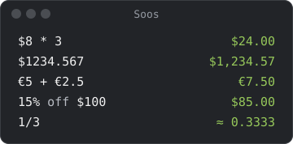
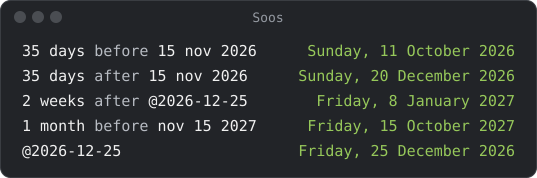

# Soos guide

Type on the left, read the answer on the right. The answers in these
pictures come from Soos itself, and a test fails if they change.

## Get started

- [Quick guide](../README.md#quick-guide): your first document, with totals and a variable.

## How-to guides

- [Install Soos](install-help.md), and get past the first-run warning on Windows or macOS.
- [Update Soos](update.md)
- [Uninstall Soos](uninstall.md)
- [Put soos-cli on your PATH](soos-cli-path.md)
- [Add your own converter](own-converter.md)
- [Install the PowerToys Run plugin](powertoys.md) (Windows)

## Reference

### [Totals and variables](totals.md)

Labels, blocks, `sum`, `avg`, `prev` and variables.

### [Phrases](phrasing.md)

Operators in words (`plus`, `divided by`), percent (`5% on 30`,
`5% on what is 105`), and numbers (`in sci`, `in hex`).

### [Money and units](money-and-units.md)

Currency symbols, rounding and exchange rates; `sq` and `cu`; your own
units.

### [Dates and time zones](dates-and-time.md)

`35 days before 15 nov`, `today + 3 days`, `3PM PST in Tokyo`.

### [The app](the-app.md)

Tabs, copying a result, the status bar, the decimal comma, the tray icon,
the hotkey, and what each [error label](the-app.md#error-labels) means.

### [soos-cli](soos-cli.md)

The same answers in a terminal or a script: input, options, JSON output and exit status.
