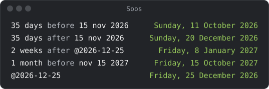

# Dates and time zones

`before` and `after` count from a date: `35 days before 15 nov 2026` is
`Sunday, 11 October 2026`.

## Writing a date

- After `before` or `after`, write `15 nov`, `nov 15` or `15 nov 2027`.
  Without a year, `15 nov` is 15 November this year.
- Anywhere else, put an `@` in front: `@2026-12-25` on its own, or plus or
  minus days, weeks, months or years: `@2026-12-25 + 1 month`. A bare
  `15 nov` is an error there.
- Without the `@`, `2026-12-25` would be 2026 minus 12 minus 25, so Soos
  shows `date needs @` instead.
- A date reads `Friday, 25 December 2026`.
- Moving a date past the years 1 to 9999 says `date out of range`.
- One date taken from another is the days between:
  `@2026-12-25 - @2026-12-01` is `24 days`, and
  `(@2026-12-25 - today) in weeks` works too.

## Today and now

These answers change with the date.

- `today`, `tomorrow`, `yesterday` and `now` work alone or plus or minus an
  amount: `today + 3 days`, `now minus 45 min`.
- Days, weeks, months and years work with all four. Minutes and hours work
  only with `now` and a [time of day](#times-of-day): `today + 2 hours` says
  `no time of day`.
- `before` and `after` work too: `3 days before today`,
  `1 week after tomorrow`.
- `now` shows the time as well: `Thursday, 8 October 2026 14:43`.

## Times of day

- `3PM`, `3:15PM` and `15:00` on their own are today at that time.
- Write `AM` and `PM` in capitals. Lowercase `am` and `pm` are the units
  attometre and picometre: `3pm` is 3 picometres, and `74 pm in nm`
  converts. A line with a lowercase time that fails (`9am PST to Tokyo`)
  says `needs AM or PM`.
- Add or take away minutes, hours or longer: `3PM + 2 hours`.
- A bare number is an error (`3PM + 2` says `needs a unit`): 2 could be
  hours or minutes.
- One time taken from another is the time between them: `3PM - 10AM` is
  `5 hours`. That is a duration like any other: `(3PM - 10AM) * 2` is
  `10 hours`, and `sum` adds durations up.
- A time of day does nothing else: `3PM * 2` and `3PM + 10AM` are errors.

## Time zones

The answer depends on the date.

- `3PM PST in Tokyo` and `now in UTC` take a city, a zone name such as
  `Asia/Tokyo`, or an abbreviation.
- A regional abbreviation, such as `PST`, `EST` or `CET`, follows daylight
  saving: while it is on, `PST` means PDT and `CET` means CEST.
- `UTC` and `GMT` never change: `GMT` is always UTC+0.
- `IST` is India and `CST` is US Central.
- A place Soos doesn't know is named in the error: `now in Atlantis` says
  `unknown Atlantis`.
