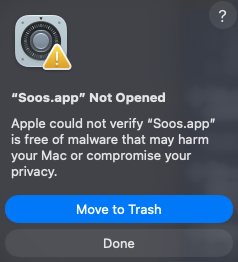

# Install help

Download Soos from the [latest release](https://github.com/marelevn/soos/releases/latest).
The builds aren't code-signed yet, so Windows and macOS warn you the first
time you open it: see [macOS](#macos-says-soosapp-not-opened)
or [Windows](#windows-shows-windows-protected-your-pc) below. To move to a
new version or remove Soos, see [Updating](#updating) and
[Uninstalling](#uninstalling).

## Where to put it

Soos keeps your tabs and settings in a `data` folder beside the program (on
macOS, in `~/Library/Application Support/Soos/`), so use a folder you'll keep
and can write to.

### Windows

1. Right-click the `.zip`, then click **Extract All**.
2. Choose a folder you'll keep.
3. Run `soos-app.exe` from the extracted `soos-windows-x86_64` folder.

To use `soos-cli` in a terminal too, see
[soos-cli on Windows](soos-cli.md#windows).

### macOS

1. Open the `.dmg`.
2. Drag Soos to Applications.
3. Open Soos from Applications.

### Linux

1. Extract the archive into a folder you can write to, such as
   `~/.local/opt`:

   ```
   mkdir -p ~/.local/opt
   tar xzf soos-linux-x86_64.tar.gz -C ~/.local/opt
   ```

2. Run `~/.local/opt/soos-linux-x86_64/soos-app`.
3. To add Soos to your applications menu, give the archive's `soos.desktop`
   the real paths and copy it into place:

   ```
   d=~/.local/opt/soos-linux-x86_64
   mkdir -p ~/.local/share/applications
   sed "s|^Exec=.*|Exec=$d/soos-app|; s|^Icon=.*|Icon=$d/soos.png|" \
     "$d/soos.desktop" > ~/.local/share/applications/soos.desktop
   ```

## Updating

Soos saves your tabs when you close it, so quit it before you update. The
downloads hold no `data` folder, so unpacking over the old copy keeps your
tabs.

### Windows

1. Quit Soos: right-click its tray icon, then click **Quit**. Closing the
   window only hides it.
2. Extract the new `.zip` into the same folder as before, and replace the
   files when Windows asks. Or extract it somewhere new and move the old
   `data` folder into the new `soos-windows-x86_64` folder.
3. Start Soos.

### macOS

Your tabs live in `~/Library/Application Support/Soos/`, not in the app, so
replacing the app keeps them.

1. Quit Soos: right-click its menu bar icon, then click **Quit**.
2. Open the new `.dmg` and drag Soos to Applications, replacing the old one.
3. The new copy is unsigned too: run `xattr -cr /Applications/Soos.app`
   again, as [below](#macos-says-soosapp-not-opened).
4. Open Soos.

### Linux

1. Close Soos.
2. Extract the new archive over the old folder (here, `~/.local/opt`, as in
   [Linux](#linux) above):

   ```
   tar xzf soos-linux-x86_64.tar.gz -C ~/.local/opt
   ```

3. Start Soos.

## Uninstalling

### Windows and Linux

1. Quit Soos.
2. Delete its folder. That deletes your tabs and settings too: they are in
   its `data` folder.
3. Remove what you set up around it, if anything:
   - Windows: the folder in your `PATH`, the
     [`SOOS_EXE`](powertoys.md#install) variable, and the PowerToys plugin
     folder
     (`%LOCALAPPDATA%\Microsoft\PowerToys\PowerToys Run\Plugins\Soos\`).
   - Linux: `~/.local/share/applications/soos.desktop` and the
     `~/.local/bin/soos-cli` link.

### macOS

1. Quit Soos.
2. Drag Soos from Applications to the Trash.
3. To delete your tabs and settings too, delete
   `~/Library/Application Support/Soos/`.
4. If you linked `soos-cli`, remove the link:
   `sudo rm /usr/local/bin/soos-cli`.

## macOS says "Soos.app" Not Opened



Gatekeeper shows this for an app that isn't signed; the download is fine.
Older macOS versions may say "Soos is damaged and can't be opened" instead;
the same steps work for it.

1. Click **Done**, not **Move to Trash**.
2. Open Terminal: press Cmd+Space, type `Terminal`, press Return.
3. Run this, which removes the "downloaded from the internet" mark (adjust
   the path if you moved Soos):

   ```
   xattr -cr /Applications/Soos.app
   ```

4. Open Soos again.

## Windows shows "Windows protected your PC"

That's SmartScreen, for an unsigned app.

1. Click **More info**.
2. Click **Run anyway**.
