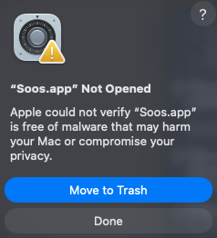

# Install Soos

Download Soos from the [latest release](https://github.com/marelevn/soos/releases/latest).
The builds aren't code-signed yet, so Windows and macOS warn you the first
time you open it: see [macOS](#macos-says-soosapp-not-opened)
or [Windows](#windows-shows-windows-protected-your-pc) below.

## Where to put it

Soos keeps your tabs and settings in a `data` folder beside the program (on
macOS, in `~/Library/Application Support/Soos/`), so use a folder you'll keep
and can write to. On Android they stay inside the app, and there's nothing
to choose.

### Windows

1. Right-click the `.zip`, then click **Extract All**.
2. Choose a folder you'll keep.
3. Run `soos-app.exe` from the extracted `soos-windows-x86_64` folder.

To use `soos-cli` in a terminal too, see
[Put soos-cli on your PATH](soos-cli-path.md#windows).

### macOS

1. Open the `.dmg`.
2. Drag Soos to Applications.
3. Open Soos from Applications.

If you use [Homebrew](https://brew.sh): run
`brew install --cask marelevn/tap/soos` instead. It clears the quarantine
flag for you, so macOS doesn't warn you, and links `soos-cli`.

### Linux

1. Extract the archive into a folder you can write to, such as
   `~/.local/opt`:

   ```
   mkdir -p ~/.local/opt
   tar xzf soos-linux-x86_64.tar.gz -C ~/.local/opt
   ```

2. Run `~/.local/opt/soos-linux-x86_64/soos-app`.
3. To add Soos to your applications menu, give the archive's `soos.desktop`
   the real paths and copy it into place:

   ```
   d=~/.local/opt/soos-linux-x86_64
   mkdir -p ~/.local/share/applications
   sed "s|^Exec=.*|Exec=$d/soos-app|; s|^Icon=.*|Icon=$d/soos.png|" \
     "$d/soos.desktop" > ~/.local/share/applications/soos.desktop
   ```

### Android

1. Download `soos-android.apk`.
2. Open it, from your browser's download notice or the Files app.
3. Android asks you once to let that app install apps (it's the setting
   called "Install unknown apps"). Allow it, go back, and tap **Install**.
4. Open Soos from your apps.

It needs Android 8 or newer on a 64-bit phone. Soos isn't on Google Play,
so Android doesn't update it for you: see [Update Soos](update.md#android).

## macOS says "Soos.app" Not Opened



Gatekeeper shows this for an app that isn't signed; the download is fine.
Older macOS versions may say "Soos is damaged and can't be opened" instead;
the same steps work for it.

1. Click **Done**, not **Move to Trash**.
2. Open Terminal: press Cmd+Space, type `Terminal`, press Return.
3. Run this, which removes the "downloaded from the internet" mark (adjust
   the path if you moved Soos):

   ```
   xattr -cr /Applications/Soos.app
   ```

4. Open Soos again.

## Windows shows "Windows protected your PC"

That's SmartScreen, for an unsigned app.

1. Click **More info**.
2. Click **Run anyway**.

Next: [Update Soos](update.md) · [Uninstall Soos](uninstall.md)
