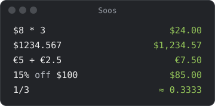
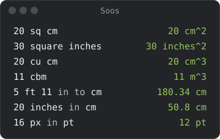
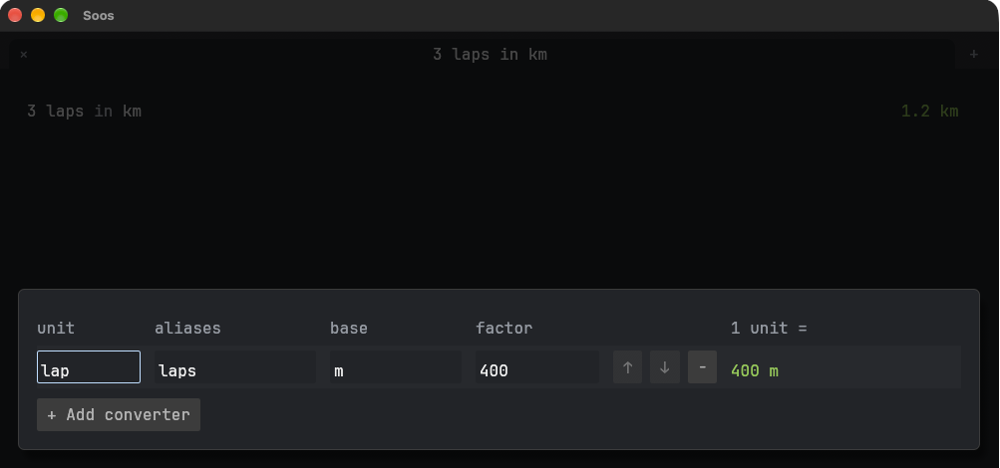

# Money and units

## Money

- Put a symbol before or after the amount (`$5` or `5$`), or write a code:
  `12 CAD`.
- A symbol works as the target of a conversion too: `5 EUR in $`,
  `$1 in ₫`.
- A plain number added to an amount takes its currency: `$5 + 1` is
  `$6.00`, as in a `sum`.
- To take a percent off, write `$100 - 15%` or `15% off $100`.
  [Percent](phrasing.md#percent)

### Symbols

`$` is US dollars and `¥` is yen, so Australian and Singapore dollars and
Chinese yuan are written `A$`, `S$` and `CN¥`. No two currencies share a
symbol. Any other currency is written and shown with its code.

| Symbol | Currency |
|---|---|
| `$` | US dollar (USD) |
| `€` | Euro (EUR) |
| `£` | Pound sterling (GBP) |
| `¥` | Japanese yen (JPY) |
| `CN¥` | Chinese yuan (CNY) |
| `₩` | South Korean won (KRW) |
| `₹` | Indian rupee (INR) |
| `₫` | Vietnamese dong (VND), written after the number: `100 ₫` (`₫100` doesn't work) |
| `฿` | Thai baht (THB) |
| `₱` | Philippine peso (PHP) |
| `Rp` | Indonesian rupiah (IDR) |
| `RM` | Malaysian ringgit (MYR) |
| `S$` | Singapore dollar (SGD) |
| `A$` | Australian dollar (AUD) |

### Rounding

- Currencies round half up to their usual decimals: `$1234.567` shows as
  `$1,234.57`, and `12.345 CAD` as `12.35 CAD`.
- Usual decimals: none for JPY, KRW, VND, IDR, ISK, CLP and others; three
  for KWD, BHD and others; two for the rest.
- `≈` marks a result that can't be written out in full, like `1/3` or
  `arcsin(1)`.
- Logarithms carry `≈` too, since they are worked out approximately:
  `log 100` is `≈ 2`.
- A `≈` amount of money rounds as above: `$10 / 3` is `≈ $3.33`.
- Any other `≈` result shows four decimals, or four significant digits
  below 1: `1/300` is `≈ 0.003333`.
- To see more digits, hover over the result or copy it. `±` in the status
  bar keeps every digit of an amount (`$1,234.567`) and shows 10 decimals
  of a `≈` result (`≈ 0.3333333333`).

### Exchange rates

- Rates come from [Frankfurter](https://frankfurter.dev), with no API key.
- They are saved on your computer, so converting keeps working offline.
- Soos fetches new ones when the saved ones are more than 6 hours old, and
  tries again after a minute if that fails.
- The status bar says when the saved rates are more than a day old.
- A document in one currency works before the first rates arrive. Only
  converting between two currencies needs them; until then it says
  `no rates yet`.

### Copying a result

Click a result to copy it without thousands separators; see
[Copying a result](the-app.md#copying-a-result).

## Units

- `sq` and `cu` work like `square` and `cubic`: `20 sq cm`, `5 cu ft`.
  `cbm` is cubic metres.
- `in` is also the unit inches: `3 in` is 3 inches, and `5 ft 11 in` is 5
  feet 11 inches.
- Between two units, `in` converts: `20 inches in cm`. As the target it is
  the unit: `5 cm to in`.
- A plain number added to a unit takes that unit: `5 m + 1` is `6 m`. Two
  units that don't convert (`5 m + 1 kg`) say `unit mismatch`.
- After a unit, `/ 2 s` divides by the whole `2 s`: `6 m / 2 s` is
  `3 m / s`, and `$40 / 2 hours` is `20 USD / hour`.
- A plain number on the left keeps the usual reading: `1/2 cup` is half a
  cup.

### Screen units

- Soos adds `px`, `pt`, `pc`, `rem`, `em` and `ch`.
- An inch is 96 px or 72 pt. A `pc` is 12 pt (16 px), `rem` and `em` are
  16 px, and `ch` is 8 px.
- `pt` is points, not pints; `pc` is picas, not parsecs; `ch` is not a
  chain. Write `pint`, `parsec` and `chain` for those.
- `rem` is the CSS unit, not the radiation dose.

## Your own converters

A converter is a unit you name, in terms of one Soos already knows. To add
one:

1. Click `↔` in the status bar. A table opens, and the window widens to
   fit it.
2. Click **+ Add converter**, then fill in the row:

   | Column | Holds | Example |
   |---|---|---|
   | unit | the name you will type | `lap` |
   | aliases | other names for it, separated by commas | `laps` |
   | base | a unit Soos already knows | `m` |
   | factor | 1 unit is this many bases: a number or a calculation | `400` |

3. Click `↔` again to close the table.
4. Use it: `3 laps in km` is `1.2 km`.

The factor may be a calculation, and a fraction stays exact:

| unit | aliases | base | factor | Then |
|---|---|---|---|---|
| `seventh` | | `m` | `1/7` | `7 seventh in m` is `1 m` |

The unit column refuses:

- a name that isn't letters, digits and `_`, starting with a letter, up to
  24 characters: `invalid unit name`;
- a [reserved word](totals.md#names-you-cant-use): `unit name reserved`;
- a name Soos or an earlier row already uses, such as `m` or `force`:
  `name already taken`.

More rules:

- `↑` and `↓` move a row; an earlier row keeps a name that two rows want.
  `-` deletes a row. `1 unit =` shows what the row means (`400 m`) or its
  error label (`needs unit, base, factor`).
- `soos-cli` uses the converters you've set in the app, once you close the
  table.
- The table is kept apart from your text, so clearing a tab never loses a
  converter.
- An alias is dropped if it isn't a valid name (`2x`), is a
  [reserved word](totals.md#names-you-cant-use) (`sum`), or is already a
  name: a unit such as `m`, or an alias an earlier row took. The rest of the
  row still works, and `1 unit =` lists the alias after `skipped:`.
- A base may hold a power of units up to 6 (`kg m^2 / s^3`); a larger one
  says `base power too large`, however it is written (`cm^9`, `cm**9`).
