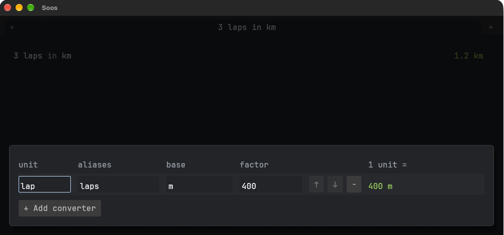

# Add your own converter

A converter is a unit you name, in terms of one Soos already knows.

1. Click `↔` in the status bar. A table opens, and the window widens to
   fit it.
2. Click **+ Add converter**, then fill in the row: unit `lap`, aliases
   `laps`, base `m`, factor `400`.
3. Click `↔` again to close the table.
4. Type `3 laps in km`. You see `1.2 km`.

If you use `soos-cli`: it picks the converter up once the table is closed.

See also: [Your own converters](money-and-units.md#your-own-converters), for
what each column holds, the names it refuses and the other rules.
