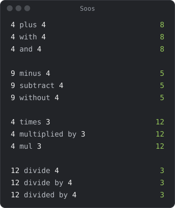
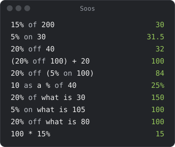
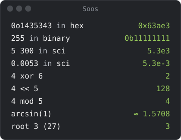

# Phrases

## Operators in words

| Symbol | Or say |
|---|---|
| `+` | `plus`, `with`, `and` |
| `-` | `minus`, `subtract`, `without` |
| `*` | `times`, `multiplied by`, `mul` |
| `/` | `divide`, `divide by`, `divided by` |

## Percent

- `15% of 200` is 30, and so is `200 * 15%`.
- `on` adds a percent and `off` takes it away: `5% on 30` is 31.5, and
  `20% off 40` is 32.
- `10 as a % of 40` is 25%, a percent like any other: on the next line,
  `prev + 1` is 125%.
- `20% of what is 30` is 150: the number that 30 is 20% of.
- `5% on what is 105` is 100: the price before 5% was added.
- `20% off what is 80` is 100: the price before 20% came off.
- `fee on cost` needs `fee` to hold a percent (`fee = 8%`); otherwise it
  says `not a percent`.

### Plus and minus a percent

- A percent typed after `+` or `-` is that percent of everything to its
  left: `30 + 5%` is 31.5, and `$100 - 15%` is $85.00.
- Each one counts from the total so far: `100 + 5% + 5%` is 110.25. In
  brackets, it counts from the bracket's start: `2 * (100 + 5%)` is 210.
- Added to a percent, it adds: `5% + 3%` is 8%, and so is `fee + 3%` with
  `fee = 5%`.
- A percent in brackets or in a variable is a plain fraction:
  `5 + (10 as a % of 40)` is 5.25.
- A percent before an amount, or in a variable beside one, says
  `needs on or off`: `15% + $100`, or `fee = 8%`, then `$100 - fee`. Write
  `$100 - 15%` or `15% off $100`.

### Where a phrase ends

- `on` and `off` take the rest of the line: `20% off 100 + 20` is 20% off
  120, which is 96.
- A phrase in brackets ends at its bracket: `(20% off 100) + 20` is 100, and
  `20% off (5% on 100)` is 84. This works for every `on`, `off`,
  `what is` and `as a % of` phrase: `(20% of what is 30) + 1` is 151, and
  `(10 as a % of 40) * 2` is 0.5: in brackets it's the fraction 0.25.
- Two phrases in a row read right to left: `5% on 20% off 100` is 5% on
  (20% off 100), which is 84.

## Numbers

- `,` groups thousands: `3,000,000` is three million, and `1,5` is 15. For
  a decimal comma, switch the status bar to `0,1`
  ([Decimal comma](the-app.md#decimal-comma)).
- A number may have spaces between its thousands: `5 300`.
- `5300 in sci` (or `to scientific`) is `5.3e3`. Soos reads that back, so a
  copied result pastes as the same number.
- `in hex`, `in binary`, `in octal` and `in base 3` convert a number.
- `0x`, `0b` and `0o` work as input, and the answer stays in that base:
  `0xff + 1` is `0x100`.

## Functions

- `arcsin`, `arccos` and `arctan` are the inverse trig functions.
- Angles are in radians unless you say `deg`: `sin 30 deg` is 0.5, and
  `sin 30` is `≈ -0.988`.
- `root 3 (27)` is the cube root of 27. The 3 must be a whole number, or
  it says `needs a whole number`.
- An odd root of a negative number is real: `root 3 (-8)` and `cbrt(-8)` are
  -2.
- A power is not a root: `(-8)^(1/3)` is the complex `≈ 1 + 1.7321i`.
- `\x. x^2` is [fend](https://github.com/printfn/fend)'s way to write a
  function: with `sq2 = \x. x^2`, `sq2 3` is 9.

## Code operators

- `&`, `|`, `xor`, `<<` and `>>` work as they do in code.
- Write `&` for a bitwise AND, since `and` is a plus.
- `^` is a power, not XOR: `2 ^ 3` is 8, and `2 xor 3` is 1.
- `mod` takes positive whole numbers: `-5 mod 3` says `can't compute`.

## Limits

Some calculations can't be stopped once started, and some would close Soos.
Soos refuses the ones it knows of before they run:

- A shift over 100,000 places, or a power over 10,000, says `too large`.
- The limit counts the whole power a line builds, variables and functions
  included: `u^20` with `u = cm^5000` is `cm^100000`, and with
  `f = \x. x^700` and `twice = \x. f(f(x))`, `twice(cm)` is `cm^490000`.
  Both are too large, and so is `t2(f)(cm)` with `t2 = \g. \x. g(g(x))`,
  which is handed `f` to call twice.
- In a function, a power of something that could be a unit needs a number:
  `\x. x^2` works, and `\x. x^y` says `needs a number`. A plain number's
  power is fine: with `pow2 = \x. 2^x`, `pow2 10` is 1,024.
- fend reads `4d6` as dice; Soos turns dice off, so `4d6` says `no dice`.
- A function can't call itself, by name, through other functions, or as
  `\x. x(x)`: it says `calls itself`. `\x. x x` reads as `x` called on
  itself too, so write `x * x` to multiply.
- Functions called inside each other too deeply say `too nested`.

A line that takes too long says `too complex`:

- fend stops most long calculations itself: `9999999!` says `too complex`.
- A line that still runs longer than 2 seconds is given up on, in the app
  and in `soos-cli`. The rest of the document and the other tabs keep
  updating, and the line runs again when you change it or a line it uses.
  One that finished just after the limit runs again once, in case the
  computer was busy.
- For now, if a second line like that comes up while Soos is still
  finishing the first in the background, every tab waits until one of them
  is done. Editing the slow line counts as a second line.

If Soos ever closes while it calculates a tab, the next launch leaves that
tab uncalculated, and says so, until you edit it.
