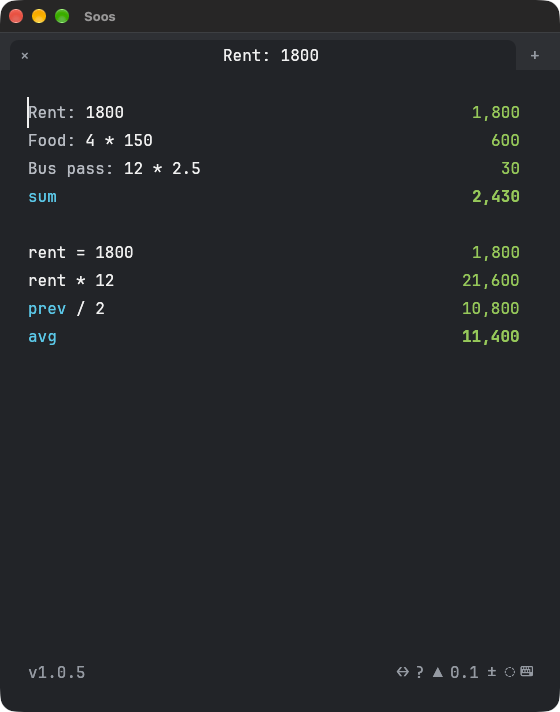
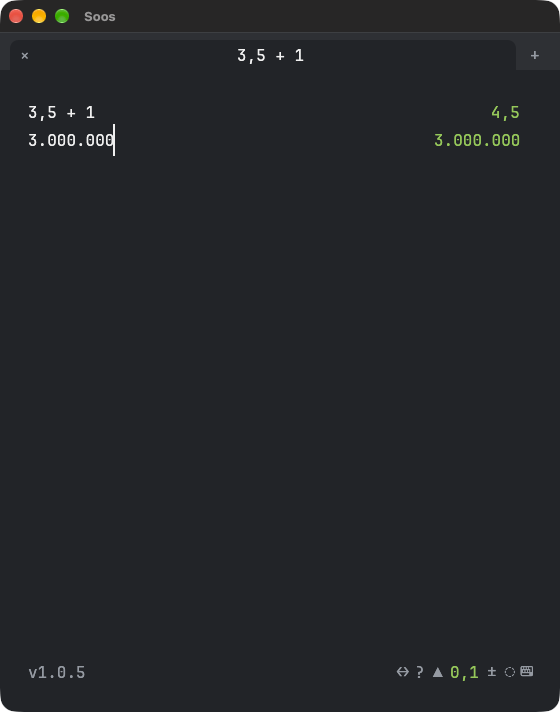

# The app

## Tabs

Up to 9, each its own scratchpad. Soos saves their text when you close it
and brings it back next time.

| To | Do |
|---|---|
| Add a tab | Click `+` in the tab strip, or press Cmd/Ctrl+T |
| Close a tab | Click the `×` on it, middle-click it, or press Cmd/Ctrl+W |
| Bring back the last one you closed | Cmd/Ctrl+Shift+T |
| Switch | Cmd/Ctrl+1-9, or Ctrl+Tab and Ctrl+Shift+Tab |
| Zoom the text | Cmd/Ctrl and `+` or `-`; Cmd/Ctrl and `0` resets it |

## The result column

- Every result ends on the column's right edge, and totals are bold.
- A result too long for the column ends in `…`; hover over it to read it
  all.
- An error shows as a short label in place of the result, such as
  `unknown metr`; hover over it for the full message. The
  [error labels](#error-labels) below say what each means.
- An error on the line you're typing waits until you pause.
- A slow document never holds up the typing: until its results are ready,
  the old ones stay, dimmed.

### Copying a result

Click a result to copy it without thousands separators: `$1,234,567.89`
copies as `$1234567.89`. It pastes back into Soos as the same amount. With
the [decimal comma](#decimal-comma) on, it copies in that form:
`$1.234.567,89` copies as `$1234567,89`.

## The status bar

Left to right. Hover over an icon to see what it does.

| Icon | Does |
|---|---|
| `↔` | Opens [your converters](money-and-units.md#your-own-converters) |
| `?` | Shows a worked example |
| `▲` | Keeps the window on top |
| `0.1` `0,1` | Decimal mark: a point or a comma. Click to switch; see [Decimal comma](#decimal-comma) |
| `±` | Shows every digit of a currency amount, and 10 decimals of a `≈` result |
| `◌` `○` `●` | Theme: follows the system, light, dark. Click to cycle |
| `⌨` | Sets the global hotkey |

The bar also shows:

- the version number: click it to check for a new version;
- `rates offline` until the first exchange rates arrive;
- `rates 2 days old` (for example) once the saved rates are more than a day
  old.

## Decimal comma

By default `,` groups thousands and `.` is the decimal mark, so `3,000,000`
is three million and `1,5` is 15. To write one and a half as `1,5`:

1. Click `0.1` in the status bar. It turns into `0,1`.
2. Type `,` for the decimal mark and `.` between thousands: `3,5 + 1` is
   `4,5`, and `3.000.000` is three million.

Click `0,1` to switch back.

- It is one setting for the whole app, saved with your tabs: it covers every
  tab and stays on after a restart.
- Results follow the setting too, and so does a converter's factor.
- Only how numbers are read and shown changes: the document is saved as you
  typed it.
- `soos-cli` always reads and prints a point: `1,234.5`.

## Tray, Dock and hotkey

A tray icon (the menu bar on macOS): click it to show the window,
right-click it for Quit.

| | Windows | macOS | Linux |
|---|---|---|---|
| Closing the window | hides it to the tray | minimizes it; the Dock icon brings it back | quits |
| Global hotkey shows and hides it | Calculator key | Ctrl+Shift+Space; hiding also removes the Dock icon | none |
| Always on top `▲` | yes | yes | none |

- To change the hotkey, click `⌨`, then press the new key.
- If the tray icon fails to appear on Windows or macOS, closing the window
  quits instead of hiding it.

### Linux

- Wayland can't do a global hotkey, always-on-top or hiding to the tray, so
  Soos turns all three off on every Linux desktop, X11 included.
- Some desktops (GNOME without an AppIndicator extension) show no tray at
  all.

## Error labels

The labels this guide mentions, as Soos shows them. The converter labels
show in the converter table, the others beside the line.

| Label | Means | More |
|---|---|---|
| `unknown` and a name (`unknown metr`) | A name Soos doesn't know: a typo, a label used as a variable, or a variable not set yet | [Totals and variables](totals.md) |
| `can't compute` | The calculation failed, such as `-5 mod 3`; hover for the reason | [Code operators](phrasing.md#code-operators) |
| `unit mismatch` | Two units that don't convert: `5 m + 1 kg` | [Units](money-and-units.md#units) |
| `no rates yet` | A conversion between currencies before the first exchange rates arrive | [Exchange rates](money-and-units.md#exchange-rates) |
| `invalid unit name` | A converter name that isn't letters, digits and `_` | [Your own converters](money-and-units.md#your-own-converters) |
| `unit name reserved` | A converter named like a built-in word | [Your own converters](money-and-units.md#your-own-converters) |
| `name already taken` | A converter name Soos or an earlier row already uses | [Your own converters](money-and-units.md#your-own-converters) |
| `base power too large` | A converter base with a power over 6 | [Your own converters](money-and-units.md#your-own-converters) |
| `needs on or off` | A percent before an amount, or in a variable beside one: `15% + $100` | [Plus and minus a percent](phrasing.md#plus-and-minus-a-percent) |
| `not a percent` | `on` or `off` after a name that doesn't hold a percent | [Percent](phrasing.md#percent) |
| `needs a whole number` | A root that isn't whole: `root 2.5 (27)` | [Functions](phrasing.md#functions) |
| `too large` | A shift over 100,000 places or a power over 10,000 | [Limits](phrasing.md#limits) |
| `too complex` | A calculation fend stops, such as `9999999!`, or a line that runs longer than 2 seconds | [Limits](phrasing.md#limits) |
| `calls itself` | A function that calls itself: `f = \x. f(x)` | [Limits](phrasing.md#limits) |
| `too nested` | Brackets, or functions called inside each other, nested too deeply | [Limits](phrasing.md#limits) |
| `needs a number` | A power of a unit inside a function, when the power isn't a number: `\x. x^y` | [Limits](phrasing.md#limits) |
| `no dice` | Dice such as `4d6` | [Limits](phrasing.md#limits) |
| `error in block` | `sum` or `avg` of a block with an error in it | [How sum and avg count](totals.md#how-sum-and-avg-count) |
| `percent in block` | `sum` of amounts and percents together | [How sum and avg count](totals.md#how-sum-and-avg-count) |
| `nothing to average` | `avg` of an empty block | [How sum and avg count](totals.md#how-sum-and-avg-count) |
| `too many lines` | A block too long to add up | [How sum and avg count](totals.md#how-sum-and-avg-count) |
| `nothing above` | `prev` with no result on a line above it | [Variables and prev](totals.md#variables-and-prev) |
| `reserved name` | A variable named like a built-in word: `sum = 5` | [Names you can't use](totals.md#names-you-cant-use) |
| `name in use` | A variable named like a unit or constant: `m = 5` | [Names you can't use](totals.md#names-you-cant-use) |
| `date needs @` | A date written without `@`: `2026-12-25` | [Writing a date](dates-and-time.md#writing-a-date) |
| `date out of range` | A date moved past the years 1 to 9999 | [Writing a date](dates-and-time.md#writing-a-date) |
| `no time of day` | Minutes or hours added to `today`: `today + 2 hours` | [Today and now](dates-and-time.md#today-and-now) |
| `needs AM or PM` | A time written with lowercase `am` or `pm` | [Times of day](dates-and-time.md#times-of-day) |
| `needs a unit` | A bare number added to a time: `3PM + 2` | [Times of day](dates-and-time.md#times-of-day) |
| `unsupported time` | Anything else done to a time of day: `3PM * 2` | [Times of day](dates-and-time.md#times-of-day) |
