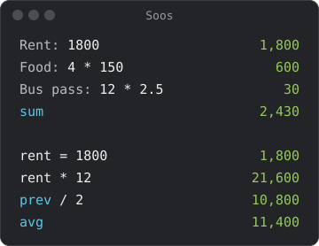

# Totals and variables

| You write | What it does |
|---|---|
| `Rent: 1800` | A label. Only what follows it is calculated. |
| a blank line, `# Heading`, `Costs:` | Starts a new block. |
| `sum` or `total` | Adds up the lines above it in its block. |
| `avg` or `average` | Averages them. |
| `prev` | Is the previous result. |
| `rent = 1800` | Makes a variable, usable on every line below. |
| `// note` or `"note"` | Is ignored. |

## Variables and prev

- A variable works on every line below the one that sets it. A later
  `rent = 2000` replaces the value from there down.
- A line that used the old value keeps it: after `x = 5`, `y = x * 2` and
  `x = 7`, `y` is still 10.
- Names are case-sensitive: after `rent = 1800`, `RENT` says
  `unknown RENT`.
- A label doesn't make a variable: after `Rent: 1800`, `rent` says
  `unknown rent`.
- `prev` is the nearest result above. It skips blank lines, headings,
  comments, labels on their own, dates and times, and lines with an error.
  After a `sum`, it is the total. With no result above, it says
  `nothing above`.

## Blocks

- A block is the lines from one start (a blank line, a `# Heading`, or a
  label alone on its line) to the next.
- `Costs:` starts a block only when it is alone on its line;
  `Rent: 1800` doesn't.

## Labels

- A label starts with a letter and may hold digits, spaces and a little
  punctuation: `Week 2:`, `Rent (monthly): 1800`, `Food & drinks: 600`.
- A `:` after anything else, such as `=`, `/` or quotes, is left to the
  calculator.

## How sum and avg count

- Every result in the block counts, including a line like `rent = 1800`.
- A date or a time of day (`today`, `3PM`) doesn't count, and neither does
  an earlier `sum` or `avg`.
- If a line in the block has an error, `sum` and `avg` show an error too
  (`error in block`), rather than a total that leaves it out.
- `sum` of an empty block is 0; `avg` of one is an error
  (`nothing to average`).
- Units that convert (`1 m` and `50 cm`) add up in the first one's unit:
  `1.5 m`.
- One unit plus plain numbers totals in that unit: `5 m`, `3` and `sum` is
  `8 m`. Two units that don't convert (`5 m`, `3 kg`) are an error.
- A percent among other amounts is an error (`percent in block`), since
  `$100` and `10%` have no total. Take it off the total instead:
  `sum - 10%` or `10% off sum`.
- A block of only percents adds up: `10%` and `20%` make `30%`.
- `prev`, `sum` and `avg` use the full value, not the digits shown.
- A block too long to add up says `too many lines`; a blank line starts a
  new one. The limit depends on how long the numbers are: over 200 lines of
  amounts like `$1234.56`, fewer of longer numbers.

## Names you can't use

These can't be a variable or a
[converter](money-and-units.md#your-own-converters) name: `sum`, `total`, `avg`,
`average`, `prev`, `today`, `tomorrow`, `yesterday`, `now`, `in`, `to`, `of`,
`on`, `off`, `as`, `before`, `after`, `into`, `plus`, `with`, `and`, `minus`,
`subtract`, `without`, `times`, `mul`, `divide`. As a variable, each says
`reserved name`.

A unit or constant can't be a variable either, because `m = 5` would make
every `1 m` below it 5: `m`, `s`, `g`, `min`, `cup`, `EUR`, `c`, `e` and `pi`
all say `name in use`. A letter that is a unit only in the other case, such
as `a` (ampere is `A`), is free.
